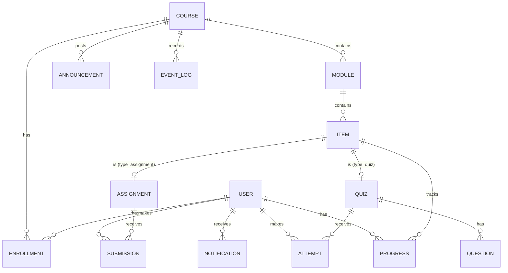

# 01. 대학 LMS 사례 조사 보고서 — 경량 LMS 설계를 위한 기초 자료

> 조사 기준일: 2026-11-03
> 범위: 국내 대학(일반대학 중심)과 해외 대학(북미·영국·아시아)의 학습관리시스템(LMS)
> 목적: ① 어떤 LMS를 어떻게 구현해 쓰는지, ② 최근 어떤 방식이 늘고 있는지, ③ 사용자 반응은 어떤지 정리하고, ④ 이를 토대로 **아주 가벼운 LMS**의 범위와 설계 방향을 정한다.
>
> 표기: 공식 자료나 언론 보도로 직접 확인하지 못한 내용은 **(확인 필요)** 로 표시했다. 시장 점유율은 조사 기관마다 기준(기관 수 / 재학생 수)이 달라 수치가 서로 다르다. 수치는 추세를 보는 용도로만 쓴다.

---

## 1. 결론 요약

| 질문 | 답 |
|---|---|
| **국내 대학은 무엇을 쓰나** | 크게 세 계열이다. ① **무들(Moodle) 기반 자체 구축**(KAIST KLMS, 연세대 LearnUs 등), ② **무들 계열 국산 솔루션**(유비온 *코스모스*), ③ **캔버스(Canvas) 계열 국산 솔루션**(자이닉스 *LearningX* — 고려대·성균관대·한양대·중앙대 등). 해외 상용 SaaS를 그대로 쓰는 곳은 드물다. 학사 연동, 동영상 진도율 출석, 스마트 출결처럼 **국내 제도에 맞춘 기능**이 필요해서다 |
| **해외 대학은 무엇을 쓰나** | 북미는 **Canvas가 사실상 표준**이다. 재학생 수 기준 약 50%이고, 2위 D2L Brightspace(약 20%)가 그 뒤를 잇는다. Blackboard는 점유율이 줄었고, 모회사 Anthology는 2025-09 파산보호를 신청했다가 2026-02에 Blackboard 단독 회사로 다시 출발했다. 유럽·아시아·남미는 **Moodle**이 여전히 넓게 쓰인다 |
| **어떻게 구현되어 있나** | 주요 제품은 모두 **모놀리식 웹 앱 + 플러그인/외부 도구 연동** 구조다. Canvas는 Ruby on Rails + React + PostgreSQL, Moodle은 PHP + MySQL/PostgreSQL, Open edX는 Django + React 마이크로 프런트엔드로 만들어졌다. 외부 도구는 **LTI 1.3** 표준으로 붙이고, 로그인은 SAML/OIDC 기반 SSO로 학교 포털과 묶는다 |
| **최근 많이 쓰는 방식** | ① 자체 서버 운영에서 **클라우드 SaaS**로 이동, ② LMS는 **허브** 역할만 하고 세부 기능은 LTI 도구로 외부화, ③ **생성형 AI 내장**(Canvas IgniteAI, Moodle AI 하위 시스템, 국내 서울시립대 AI 기반 LMS), ④ **학습분석 대시보드**, ⑤ **모바일 앱과 알림**, ⑥ **접근성 규제 대응**(미국 ADA Title II, WCAG 2.1 AA) |
| **사용자 반응** | 학생: "할 일과 마감이 한곳에 모여 있는가", "모바일에서 빠른가"로 평가한다. 교수: 강좌 준비와 채점에 드는 **클릭 수**를 가장 크게 불평한다. 국내에서는 **동영상 진도율 판정 오류**, **개강·마감 시 접속 장애**, **메뉴가 복잡한 구형 UI**에 대한 불만이 반복된다. 캔버스 계열로 바꾼 학교에서는 UI 만족도가 대체로 올라갔다. 국내 대학 LMS에 들어간 AI 챗봇은 아직 "행정 안내 수준"이라는 평가가 많다 |
| **경량 LMS 방향** | **"강좌 → 주차(모듈) → 항목"** 세 단계 구조, **학생 홈 = 다음 할 일 목록**, **과제·퀴즈·공지·성적·진도** 5가지 핵심 기능만 둔다. 단일 서버 + SQLite(필요 시 PostgreSQL)로 시작하고, LTI·SSO·AI는 **확장 지점**으로만 열어 둔다. 자세한 설계는 [8장](#8-경량-lms를-위한-시사점과-설계-방향) |

---

## 2. LMS의 기본 개념과 조사 방법

### 2.1 LMS가 하는 일

대학 LMS는 "수업 한 개(강좌)를 중심으로 사람·자료·활동·평가를 묶는 시스템"이다. 제품마다 이름은 달라도 기능은 거의 같다.

| 영역 | 대표 기능 |
|---|---|
| 강좌 운영 | 강좌 자동 개설(학사 연동), 수강생·조교 명단, 주차/모듈 구성, 공지 |
| 콘텐츠 | 파일, 페이지(본문), 외부 링크, 동영상(진도 추적), SCORM 패키지 |
| 활동 | 과제 제출, 퀴즈/시험, 토론, 팀 프로젝트, 설문 |
| 평가 | 채점(루브릭), 피드백, 성적부, 성적 내보내기(학사 시스템 반영) |
| 출석 | 온라인 출석(동영상 진도율), 오프라인 전자출결(인증번호·블루투스·QR) |
| 소통 | 알림(앱 푸시·메일), 메시지, Q&A 게시판 |
| 연동 | SSO, 학사정보시스템, 화상강의(Zoom·Webex), 표절 검사, 외부 도구(LTI) |
| 분석 | 접속·진도·제출 현황, 위험 학생 조기 경보, 학습분석 대시보드 |

### 2.2 조사 방법과 한계

- 대학 공식 안내 페이지, 대학 신문, 언론 보도, 업계 분석(On EdTech, Edutechnica), 표준 단체(1EdTech) 자료, 국내 학술지 논문을 참고했다. 출처는 [10장](#10-출처)에 모았다.
- 국내 대학별 LMS의 **내부 기반 기술**(무들인지, 캔버스인지)은 대학이 공식적으로 밝히지 않는 경우가 많다. 이런 내용은 커뮤니티 자료로만 확인되면 **(확인 필요)** 로 표시했다.
- 사용자 반응은 전국 단위 통계가 거의 없다. 개별 대학 설문, 학술 연구, 학생 신문 보도를 종합했다. 따라서 "경향"으로 읽어야 한다.

---

## 3. 국내 대학 사례

### 3.1 시장 구조 — 세 갈래

```
                      ┌─ ① 무들 직접 커스터마이징 (대학 자체 개발팀 운영)
  오픈소스 무들(PHP) ─┤
                      └─ ② 무들 계열 국산 솔루션 ── 유비온 "코스모스(Coursemos)"
  오픈소스 캔버스(Rails) ── ③ 캔버스 계열 국산 솔루션 ── 자이닉스 "LearningX"
  (소수) 상용 해외 SaaS ── 과거 블랙보드 등 → 대부분 ①~③으로 전환
```

- **왜 해외 SaaS를 그대로 쓰지 않나** — 국내 대학은 ⓐ 학사 시스템(수강신청·성적)과 실시간 연동, ⓑ 「대학 등의 원격수업 운영에 관한 훈령」에 맞춘 **출석·진도 관리**, ⓒ 한국어 UI·카카오톡 등 국내 알림 채널, ⓓ 개강 첫 주 같은 **순간 폭주 대응**을 요구한다. 그래서 오픈소스(무들·캔버스)를 가져와 국내 업체가 **현지화·통합 구축**하는 방식이 자리 잡았다.
- 고려대 원격교육센터는 블랙보드에서 LearningX로 옮긴 이유로 "사용자 몰림에 대응할 수 있는 성능, 스마트 출결, 국내 대학에 적합한 인터페이스, 원활한 모바일 환경"을 들었다(고대신문). 국내 대학이 무엇을 중요하게 보는지 그대로 보여 주는 사례다.

### 3.2 대학별 사례

| 대학 | 시스템 이름 | 기반 / 공급 | 특징·비고 |
|---|---|---|---|
| 서울대 | eTL | 무들 계열로 알려짐 **(확인 필요)** | 교수학습개발센터가 개발·운영한다 |
| 연세대 | LearnUs | 무들 기반 (연세대 공식 안내) | 원주캠퍼스까지 함께 쓰는 통합 LMS. 다양한 교수학습 도구를 플러그인으로 붙였다 |
| KAIST | KLMS | 무들 기반 (KAIST CELT 공식 안내) | 학사 시스템과 연동해 정규 강좌를 자동으로 지원한다 |
| 고려대 | LMS (LearningX) | 블랙보드 → **LearningX(자이닉스)** | 고대신문이 "탈 많던 블랙보드"라고 표현했을 만큼 이전 시스템 불만이 컸다. 전환 이유는 성능, 스마트 출결, 국내형 UI, 모바일 |
| 성균관대 | i-Campus | LearningX 기반 | 온라인·블렌디드·오프라인 수업을 모두 지원하는 "가상수업시스템"으로 구축했다 |
| 한양대 | HY-ON LMS | LearningX (교수·학생 앱 모두 LearningX) | 캔버스 계열로 알려짐 **(확인 필요: 커뮤니티 자료)** |
| 중앙대 | e-class | LearningX | 2018년 보도 기준 **국내 대학 최초 LearningX 도입** |
| 부산외대 | — | LearningX | 2018년 2학기 기준 도입 |
| 서울시립대 | 차세대 LMS | **유비온** 공동 개발 | 2026학년도 1학기부터 **AI 기반 차세대 LMS** 전면 도입. 출석·활동·성취 데이터를 통합 분석하는 학습분석 대시보드를 갖췄다 |
| 부산대·세종대 등 | PLATO 등 | 코스모스(무들 계열) 사용으로 알려짐 **(확인 필요)** | 부산대는 2020-03 온라인 개강 첫날 "잦은 오류"가 보도됐다 |

> 유비온은 자사 통합 학습 플랫폼 *코스모스 LXP*를 160여 개 기관이 쓴다고 밝혔다(2025-12, 기업 포함, 회사 측 수치).

### 3.3 국내 LMS에서 특히 중요한 기능

해외 제품에는 없거나 약한데, 국내 대학이 반드시 요구하는 기능이다. 경량 LMS도 국내에서 쓰려면 이 기능부터 검토해야 한다.

| 기능 | 내용 | 구현 방식 |
|---|---|---|
| **학사 연동** | 수강신청 결과로 강좌·수강생을 자동 생성하고, 성적을 학사 시스템으로 보낸다 | 학사 DB 뷰나 배치 파일(CSV)을 매일 또는 실시간으로 동기화한다. 해외에서는 OneRoster·LIS 표준을 쓴다 |
| **동영상 진도율 출석** | 주차별 학습 기간 안에 영상의 일정 비율(예: 90%) 이상을 보면 출석으로 인정한다 | 플레이어가 재생 구간을 주기적으로 서버에 보내고, 서버가 구간을 합쳐 진도율을 계산한다. 건너뛰기 금지, 배속 제한, 기간 외 시청은 "지각" 처리 같은 정책을 둔다 |
| **원격수업 제도 준수** | 훈령에 따라 출석관리, 평가관리, 콘텐츠 분량을 맞춘다. 예를 들어 한 대학 규정은 콘텐츠를 "1학점 기준 주차당 25분 이상"으로 정한다 | 강좌 설정에 "원격/혼합/대면" 구분, 주차별 학습 인정 기간, 콘텐츠 분량 점검 기능을 둔다 |
| **스마트(전자) 출결** | 대면 수업에서 인증번호·블루투스·QR로 출석을 받는다 | 교수 앱이 일회용 코드를 띄우고, 학생 앱이 제한 시간 안에 입력한다. 위치·기기 정보로 대리 출석을 막는다 |
| **대리 출석 방지** | 원격수업 중 본인 인증을 요구한다 | 일부 대학은 강의 콘텐츠에 접속할 때 SMS 본인 인증을 요구했다(국내 연구 보고) |
| **화상강의 연동** | Zoom·Webex·Teams 실시간 강의 링크와 녹화본을 LMS에서 연다 | LTI 또는 회의 API로 연동하고, 접속 기록을 출석에 반영한다 |
| **모바일 앱** | 알림, 출석, 동영상 시청을 앱에서 한다 | 솔루션 업체가 공통 앱을 제공한다(예: LearningX Student/Teacher) |

### 3.4 국내 사용자 반응

**학생**
- **접속 장애**: 2020-03 코로나19로 온라인 개강을 할 때 여러 대학 LMS가 몰리는 접속을 감당하지 못했다. 부산대는 "잦은 오류"가 보도됐고, 부경대는 서버를 2대에서 4대로 늘렸다. 반대로 선문대·배재대는 미리 서버를 늘리고 교직원 교육을 해서 "서버 다운 없음"으로 호평을 받았다. **피크 대응이 신뢰를 결정한다**는 교훈이 남았다.
- **진도율 판정 불신**: "끝까지 봤는데 진도가 반영되지 않았다", "창을 바꾸면 재생이 멈춘다", "배속 재생이 막혀 있다" 같은 불만이 대학 커뮤니티에서 학기마다 반복된다(유형 정리, 개별 통계 없음). 출석이 성적과 연결되니 **판정 근거를 학생이 볼 수 있어야** 한다.
- **정보가 흩어짐**: 공지가 LMS·학교 포털·메일·단체 채팅방에 나뉘어 있어 마감을 놓친다는 불만이 많다. 학생들이 직접 여러 LMS의 마감일을 모아 보는 비공식 도구(예: 크롬 확장 프로그램 "MyCourse")를 만들어 쓸 정도다. 학생에게 필요한 것은 **"내가 오늘 해야 할 일" 한 화면**이다.
- **구형 UI**: 블랙보드나 오래된 무들 테마처럼 메뉴가 깊고 복잡한 시스템에 대한 불만이 컸다. 고려대처럼 캔버스 계열로 바꾼 학교에서는 화면이 단순해졌다는 평가가 나왔다.
- **강의 품질 불만**: 시스템 문제와 별개로, 녹화 영상의 질이 낮다는 불만도 2020년에 크게 보도됐다. LMS가 해결할 문제는 아니지만, **교수자가 콘텐츠를 쉽게 만들고 고칠 수 있는 도구**가 간접적으로 품질에 영향을 준다.

**교수자**
- 강좌 준비(주차 구성, 자료 업로드, 과제 설정)와 채점에 드는 클릭 수가 가장 큰 부담이다.
- 학기마다 강좌를 새로 만드는 일이 반복된다. **이전 학기 강좌 복사** 기능의 품질이 만족도를 크게 좌우한다.
- LMS가 불편하면 단체 채팅방, 구글 클래스룸, 노션 같은 외부 도구로 수업을 운영한다. 그러면 학생 쪽에서는 정보가 더 흩어진다.

**AI 기능**
- 2025-11 발표된 국내 연구는 7개 대학 LMS에 들어간 AI 챗봇을 분석했다. 대부분 **기초적인 행정 지원**에 머물렀고, 학습자 맥락 이해나 개인 맞춤 피드백은 제한적이었다. 사용자는 **수업 연계 부족, 정형화된 응답, 낮은 인지도**를 지적했다. 이름은 "AI 조교"인데 실제 기능은 FAQ 수준이라는 괴리도 확인됐다.

---

## 4. 해외 대학 사례

### 4.1 시장 동향

**북미 고등교육 점유율 (재학생 수 기준, 2024년 말, On EdTech)**

| 제품 | 점유율 | 추세 |
|---|---|---|
| Instructure **Canvas** | 약 50% | 계속 상승. 2025년 미국 조사(Edutechnica)에서는 2~4위를 합친 것보다 많다 |
| D2L **Brightspace** | 약 20% | 상승. LMS를 바꾸는 학교는 대부분 Canvas나 Brightspace로 간다 |
| **Blackboard** (Anthology) | 약 12% | 하락 |
| **Moodle** | 약 9% | 미국에서는 완만한 하락, 전 세계적으로는 여전히 가장 넓게 쓰인다 |
| Sakai 등 | 소수 | 하락 |

**2024~2026년 주요 사건**

| 시기 | 사건 | 의미 |
|---|---|---|
| 2024 | 사모펀드 KKR이 Instructure(Canvas) 인수, 비상장 전환 | 1위 업체의 투자 여력 확대, 가격 정책 변화 우려 |
| 2025-04 / 2025-10 | Moodle 5.0 / 5.1 출시 | UI 현대화, 활동 개요 통합, **강좌·활동 단위로 AI를 켜고 끄는 기능**, AI 공급자 추가(DeepSeek 등) |
| 2025-07 | Instructure–OpenAI 제휴, **IgniteAI** 발표 | Canvas 안에서 교수자가 GPT형 과제("LLM-Enabled Assignment")를 만든다. 학생 데이터는 OpenAI와 공유하지 않는다고 밝혔다. AI 에이전트는 유료 추가 기능이다 |
| 2025-09 | Anthology(Blackboard 모회사) 파산보호(Chapter 11) 신청 | 학사행정(Enterprise) 사업은 Ellucian에, 학생 모집·관리(Lifecycle) 사업도 따로 매각. LMS(Blackboard)만 남김 |
| 2026-01~03 | 회생계획 인가 → 약 16억 달러 부채 정리 → **Blackboard 단독 회사로 출범·사명 변경** | 3위 업체의 구조조정. 고객 학교는 공급사 지속성을 다시 따지게 됐다 |
| 2026-04 | 미국 법무부, ADA Title II 웹 접근성 준수 기한 **1년 연장**(2027-04) | 공립대학의 LMS 강좌 콘텐츠도 WCAG 2.1 AA 대상이다. 연장됐어도 요구 수준은 그대로다 |

### 4.2 대학별 사례

| 지역 | 대학 | LMS | 비고 |
|---|---|---|---|
| 미국 | Harvard, MIT, Stanford | Canvas | MIT는 자체 시스템(Stellar)에서 Canvas로 옮겼다 |
| 미국 | UC Berkeley | Canvas ("bCourses") | 학교 고유 이름을 붙여 운영 |
| 캐나다 | University of Toronto | Canvas ("Quercus") | 학교 고유 이름을 붙여 운영 |
| 영국 | University of Oxford | Canvas | Sakai 기반 자체 시스템(WebLearn)을 대체했다. SSO로 로그인 |
| 영국 | The Open University | Moodle | 세계 최대급 원격대학의 대규모 무들 운영 사례 |
| 영국 | University of Cambridge | Moodle **(확인 필요)** | |
| 네덜란드 | TU Delft, Leiden 등 | Brightspace **(확인 필요)** | 유럽에서 Brightspace가 늘어난 사례 |
| 싱가포르 | NUS | Canvas | 자체 개발 LumiNUS를 2023년까지 Canvas로 교체 |
| 일본 | 다수 대학 | Moodle, manaba(아사히넷) 등 | 국립대는 무들 자체 운영이 많다 |
| 중국 | 칭화대 등 | 雨课堂(Rain Classroom), 学习通 | **위챗(WeChat) 미니 프로그램**과 PPT 플러그인으로 동작하는 초경량 방식. 별도 앱 설치 없이 메신저 안에서 출석·퀴즈를 한다 |
| 전 세계(MOOC) | edX 참여 대학 | Open edX | 대규모 공개강좌용. 저작 도구(Studio)와 수강 화면(LMS)이 분리되어 있다 |

**관찰 포인트**
1. 자체 개발 LMS(MIT Stellar, Oxford WebLearn, NUS LumiNUS)를 **상용 SaaS로 교체**하는 흐름이 뚜렷하다. 유지보수 인력, 모바일 앱, 접근성, 보안 대응 비용을 대학이 혼자 감당하기 어렵기 때문이다.
2. 학교마다 고유 이름(bCourses, Quercus)을 붙여 **브랜드는 학교가, 플랫폼은 SaaS가** 맡는 방식이 일반적이다.
3. 중국 雨课堂은 **이미 모두가 쓰는 메신저 위에 얹은 LMS**다. "앱을 하나 더 깔게 하지 않는다"는 점에서 경량 LMS에 시사점이 크다.

### 4.3 해외 사용자 반응

- **Canvas vs Blackboard**: 미국 공과대학 연구(ASEE)에서 학생 137명 중 61%가 Canvas를 선호했다. 자료 찾기와 탐색 과제에서 Canvas 점수가 높았다. 다만 University of Washington 평가처럼 "교수 만족도는 높고 학생은 중립"인 결과도 있다. 학생은 LMS 자체보다 **교수가 강좌를 얼마나 잘 정리했는가**에 더 영향을 받는다.
- **Blackboard**: 학생 신문에서는 "구식 인터페이스", "기능을 찾기 어렵다"는 불만이 꾸준히 나왔다. 신형 Ultra 화면은 이를 개선하려는 시도다.
- **Moodle**: 기능이 가장 많고 유연하지만, 기본 화면이 복잡하고 **테마·설정에 따라 사용성 편차가 크다**는 평가가 많다. 5.x에서 교수자 경험을 집중적으로 개선하고 있다.
- **AI 기능**: 교수자는 채점·피드백 보조를 반기지만, 개인정보와 학업 윤리 우려 때문에 **기관 단위로 AI를 끄는 학교도 있다**(예: 한 플로리다 대학은 Canvas에 LLM을 연동하지 않겠다고 공지). 벤더가 AI를 유료 추가 기능으로 파는 데 대한 반감도 있다.
- **전환 피로**: LMS를 바꾸면 교수자가 강좌를 옮기고 다시 익혀야 한다. 그래서 만족도와 별개로 **이전 비용** 때문에 전환을 미루는 경우가 많다. 강좌 내보내기·가져오기(Common Cartridge) 지원 여부가 중요한 이유다.

---

## 5. 구현 방식 비교

### 5.1 주요 제품의 기술 구조

| 제품 | 형태 | 기술 스택 | 라이선스 | 확장 방식 | 경량 LMS에 주는 시사점 |
|---|---|---|---|---|---|
| **Canvas** | 오픈소스 + 클라우드 SaaS(AWS) | Ruby on Rails 모놀리스, React(구 jQuery/Backbone 교체 중), PostgreSQL, Redis | AGPL-3.0 | LTI 1.3 도구, REST API, 엔진/플러그인 | **"강좌 → 모듈 → 항목"** 의 단순한 정보 구조와 **할 일(To-Do)·캘린더 중심** 학생 화면이 높은 만족도의 핵심 |
| **Moodle** | 오픈소스, 자체 설치 또는 파트너 호스팅 | PHP 모놀리스, MySQL/MariaDB/PostgreSQL | GPL-3.0 | **40종 이상 플러그인 타입, 2,000개 이상 플러그인** | 확장성은 최고지만 기능이 많아 UI가 복잡해진다. **핵심만 남기고 나머지는 확장 지점으로** |
| **Blackboard Learn (Ultra)** | 상용 SaaS | Java 기반(구 버전은 설치형) | 상용 | Building Block, LTI, REST | 오래된 화면(Classic)과 신형(Ultra)의 공존이 사용자 혼란을 키웠다. **화면 체계는 하나로** |
| **D2L Brightspace** | 상용 SaaS | 비공개 | 상용 | LTI, API, 위젯 | 역량(Competency) 기반 평가, 접근성으로 평가가 좋다 |
| **Open edX** | 오픈소스 | Django 모놀리스(LMS+Studio) + 독립 서비스 + React 마이크로 프런트엔드 | AGPL-3.0 | **XBlock**(Python 컴포넌트) | 대규모에는 강하지만 설치·운영이 무겁다. 경량에는 맞지 않다 |
| **Sakai** | 오픈소스 | Java | ECL-2.0 | 도구(Tool) 단위 | 점유율 하락 중 |
| **Google Classroom** | 무료/교육용 SaaS | 비공개(Google Workspace 통합) | 상용 | Workspace 도구, 일부 LTI | **기능은 적어도 빠르고 쉽다**는 이유로 대학 교수자도 개인적으로 많이 쓴다. "가벼움"의 기준점 |
| **LearningX** (자이닉스) | 국산 상용 | Canvas 계열로 알려짐 **(확인 필요)** | 상용 | 국내 학사·출결·화상강의 연동 | 오픈소스를 현지화하는 국내 표준 모델 |
| **코스모스** (유비온) | 국산 상용 | 무들 계열로 알려짐 **(확인 필요)** | 상용 | 국내 학사·출결 연동, AI·학습분석 | 위와 같음 |

### 5.2 공통 도메인 모델

제품마다 이름만 다를 뿐, 내부 데이터 구조는 거의 같다.

```
기관(Institution)
 └─ 학기(Term)
     └─ 강좌(Course) ── 분반(Section)
         ├─ 수강 등록(Enrollment: 사용자 × 강좌 × 역할[교수/조교/학생/청강])
         ├─ 모듈/주차(Module)
         │   └─ 항목(Item): 페이지 | 파일 | 링크 | 동영상 | 과제 | 퀴즈 | 토론 | 외부도구(LTI)
         ├─ 과제(Assignment) ── 제출(Submission) ── 채점(Grade/Feedback/Rubric)
         ├─ 퀴즈(Quiz) ── 문항(Question, QTI) ── 응시(Attempt)
         ├─ 성적부(Gradebook: 항목별 가중치·카테고리)
         ├─ 공지(Announcement) / 토론(Discussion)
         └─ 진도·출석(Progress/Attendance)
알림(Notification), 감사 로그(Audit Log), 파일 저장소(Object Storage)
```

### 5.3 연동 표준

| 표준 | 용도 | 현황 | 경량 LMS 판단 |
|---|---|---|---|
| **LTI 1.3 / LTI Advantage** (1EdTech) | LMS에 외부 도구를 붙이는 표준. OIDC 로그인 + JWT 서명. 성적 반환(AGS), 콘텐츠 선택(Deep Linking), 명단 조회(NRPS) | 현재 표준. LTI 1.1은 지원 종료. Schoology, Microsoft 365 등이 1.3으로 이동 | P2에서 **LTI 1.3 플랫폼** 역할 지원 |
| **SCORM 1.2 / 2004** | 패키지형 e러닝 콘텐츠 | 기업 교육에서 많이 쓰고, 대학에서는 줄어드는 중 | 범위 밖 |
| **xAPI / cmi5** | 학습 활동 기록("누가 무엇을 했다") | 학습분석용으로 늘어나는 중 | 내부 이벤트 로그를 xAPI 형식과 호환되게 설계만 해 둔다 |
| **QTI** | 문항·시험 교환 | 문제은행 이전용 | P2 가져오기/내보내기 |
| **Common Cartridge** | 강좌 전체 내보내기·가져오기 | LMS 전환 때 중요 | P2 |
| **OneRoster / LIS** | 학사 시스템과 명단·성적 동기화 | 북미 중심 | 국내는 CSV 연동으로 시작 |
| **SAML 2.0 / OIDC** | 학교 통합 로그인(SSO) | 거의 모든 대학이 사용 | P1에서 OIDC 지원 |

### 5.4 배포·운영 방식

| 방식 | 예 | 장점 | 단점 |
|---|---|---|---|
| 멀티테넌트 SaaS | Canvas Cloud, Brightspace, Blackboard SaaS | 업데이트·보안·확장을 업체가 책임진다 | 비용, 데이터 주권, 맞춤 개발 제약 |
| 업체 구축형(온프레미스·전용 클라우드) | 국내 LearningX·코스모스 다수 | 학사 연동·국내 제도 맞춤이 쉽다 | 대학별 버전이 갈라져 업데이트가 느리다 |
| 대학 자체 운영 오픈소스 | KAIST KLMS(무들), Open University(무들) | 완전한 통제 | 개발·운영 인력이 계속 필요하다 |
| 메신저/생산성 도구 위 경량 | 雨课堂(위챗), Google Classroom | 설치·학습 비용이 거의 없다 | 기관 단위 관리·평가 기능이 약하다 |

---

## 6. 최근 트렌드 (2024~2026)

1. **SaaS 집중과 업체 재편** — 북미는 Canvas·Brightspace 두 회사로 모이고, Blackboard는 구조조정을 거쳤다. 대학은 "기능"만큼 **공급사의 지속성**과 **데이터를 들고 나갈 수 있는가**(내보내기 표준)를 따진다.
2. **LMS는 허브, 기능은 바깥으로** — 표절 검사, 동영상, 실습 환경, 교재, 화상강의는 LTI 도구로 붙인다. LMS 본체는 **명단·구조·성적·알림**이라는 뼈대에 집중한다.
3. **생성형 AI 내장, 그리고 통제권** — Canvas(IgniteAI·OpenAI), Moodle(AI 하위 시스템, 5.1에서 강좌·활동별 on/off), Blackboard(AI Design Assistant), D2L(Lumi), 국내 서울시립대(AI 기반 LMS)가 모두 AI를 넣었다. 공통 쟁점은 **교수자가 켜고 끌 수 있는가**, **학생 데이터가 밖으로 나가는가**, **유료 추가 기능인가**다. 국내 연구는 "수업과 연결되지 않은 챗봇"은 쓰이지 않는다는 점을 보여 준다.
4. **학습분석 대시보드** — 출석·제출·진도를 한 화면에 모아 위험 학생을 일찍 찾는다(서울시립대 사례). 다만 학생 감시로 받아들여지지 않도록 **학생 본인에게도 같은 데이터를 보여 주는** 방향이 늘고 있다.
5. **모바일 우선과 알림** — 학생 접속의 상당 부분이 휴대폰에서 일어난다. 알림이 너무 많으면 꺼 버리고, 너무 적으면 마감을 놓친다. **요약 알림**(하루 한 번 "오늘 할 일")이 늘고 있다.
6. **접근성 규제** — 미국 ADA Title II(WCAG 2.1 AA, 기한 2027-04로 연장), 국내 장애인차별금지법과 **한국형 웹 콘텐츠 접근성 지침(KWCAG) 2.2**. 업체 UI뿐 아니라 **교수자가 올린 콘텐츠**(PDF·영상 자막)까지 대상이다.
7. **"가벼운 도구"의 병행 사용** — 공식 LMS가 무거우면 교수자는 구글 클래스룸·노션·단체 채팅방을 함께 쓴다. 이는 **필요 최소 기능을 빠르게 제공하는 LMS**에 대한 수요가 있다는 신호다.
8. **국내 특유의 흐름** — ① 해외 오픈소스를 국산 솔루션으로 현지화(LearningX·코스모스), ② 블랙보드 등 해외 상용에서 국산으로 전환, ③ 2026년부터 "AI 기반 차세대 LMS" 교체 사업 증가.

---

## 7. 사용자 반응 종합

### 7.1 역할별로 좋아하는 것과 싫어하는 것

| 역할 | 좋아하는 것 | 싫어하는 것 |
|---|---|---|
| **학생** | 할 일·마감을 한곳에서 보기, 모바일에서 빠른 로딩, 제출 확인(영수증), 성적·피드백을 빨리 확인 | 정보 분산(LMS·포털·채팅방), 진도율 미반영, 마감 직전 장애, 깊은 메뉴, 앱 재로그인 |
| **교수자** | 이전 학기 강좌 복사, 드래그로 주차 구성, 한 화면에서 채점(SpeedGrader 같은 방식), 일괄 공지 | 클릭이 많은 과제 설정, 느린 파일 업로드, 성적부 계산 방식 이해 어려움, 학기마다 반복 작업 |
| **조교** | 채점 분담, 제출 현황 필터 | 권한이 너무 넓거나 좁음 |
| **관리자(대학)** | 학사 자동 연동, 피크 시간 안정성, SSO, 감사 로그, 백업 | 버전 업그레이드 부담, 업체 종속, 맞춤 개발 비용 |

### 7.2 만족도를 가르는 다섯 가지

1. **첫 화면** — 학생은 "다음 할 일", 교수는 "확인할 제출물"이 바로 보여야 한다.
2. **신뢰성** — 개강 첫 주, 과제 마감 직전, 시험 시간에 멈추면 다른 장점이 모두 묻힌다.
3. **판정의 투명성** — 출석·진도·성적 계산 근거를 학생이 직접 볼 수 있어야 한다.
4. **교수자 작업량** — 강좌 준비와 채점의 클릭 수가 교수자 채택률을 결정한다.
5. **이동성** — 데이터를 들고 나갈 수 있어야(내보내기) 기관이 안심하고 쓴다.

---

## 8. 경량 LMS를 위한 시사점과 설계 방향

### 8.1 설계 원칙

| # | 원칙 | 근거 |
|---|---|---|
| 1 | **"강좌 → 주차(모듈) → 항목" 세 단계만** 둔다 | Canvas 계열의 높은 만족도, 무들의 복잡도 문제 |
| 2 | **학생 홈 = 다음 할 일 목록**(전 강좌 통합, 마감순) | 정보 분산이 학생 불만 1순위. 학생들이 마감 모음 도구를 직접 만들어 쓴다 |
| 3 | **교수자 홈 = 확인할 일**(채점 대기, 미제출자, 질문) | 교수자 작업량이 채택을 결정한다 |
| 4 | 핵심 기능은 **5개**: 자료·과제·퀴즈·공지·성적(+진도) | 나머지는 확장 지점으로 둔다. Moodle처럼 기능이 많을수록 UI가 무거워진다 |
| 5 | **모든 판정은 근거와 함께** 보여 준다(진도 구간, 제출 시각, 점수 계산식) | 국내 진도율 불신 |
| 6 | **단일 프로세스·단일 DB**로 시작하고, 피크는 설계로 버틴다 | 2020 접속 장애. 경량이어도 마감 직전 폭주는 반드시 온다 |
| 7 | **모바일 웹 우선**, 앱 설치 없이 동작(PWA) | 雨课堂·Google Classroom의 낮은 진입 비용 |
| 8 | **표준 형식으로 내보내기**를 처음부터 둔다(CSV·JSON, 이후 Common Cartridge) | 전환 피로, 업체 종속 우려 |
| 9 | **접근성 WCAG 2.1 AA / KWCAG 2.2**를 기본값으로 | 국내외 규제 |
| 10 | **AI는 꺼진 상태가 기본**, 강좌 단위로 교수자가 켠다 | Moodle 5.1의 방식, 개인정보 우려, 국내 챗봇 연구 |

### 8.2 기능 범위 (우선순위)

**P0 — MVP (한 학교·한 학기 수업을 실제로 돌릴 수 있는 최소 기능)**
- **계정**: 이메일+비밀번호 로그인, 비밀번호 재설정, 역할(관리자·교수·조교·학생)
- **강좌**: 생성, 수강생 초대(CSV 일괄 등록·초대 코드), 강좌 복사(이전 학기)
- **주차/모듈**: 생성·순서 변경·공개 예약(날짜)
- **항목**: 페이지(마크다운), 파일, 링크, 동영상(외부 URL 또는 업로드 + 진도 추적), 과제, 퀴즈
- **과제**: 마감·지각 허용 정책, 파일/텍스트 제출, 재제출, **제출 영수증**(시각·파일 해시), 채점·코멘트
- **퀴즈**: 객관식·단답형·서술형, 자동 채점(객관식/단답), 응시 시간 제한, 응시 기간
- **공지**: 강좌 공지 + 알림
- **성적부**: 항목별 점수, 가중치 카테고리, CSV 내보내기, 학생 본인 성적 보기
- **진도·출석(온라인)**: 동영상 시청 구간 기록 → 진도율 → 주차별 출석 인정(정책 설정 가능)
- **학생 홈**: 전 강좌 통합 "할 일" + 캘린더
- **교수자 홈**: 채점 대기, 미제출자, 최근 질문
- **알림**: 앱 내 알림 + 이메일 요약(하루 1회)

**P1 — 운영 편의**
- 학교 SSO(OIDC), 학사 명단 CSV 자동 동기화
- 대면 전자출결(교수 화면에 일회용 코드 → 학생 입력, 유효 시간 제한)
- 토론/Q&A 게시판, 루브릭 채점, 조교 채점 분담
- PWA 푸시 알림, 다크 모드
- 학습 현황 대시보드(교수: 강좌 전체 / 학생: 본인 것)

**P2 — 확장**
- **LTI 1.3 플랫폼**(외부 도구 연결: 표절 검사, 화상강의, 실습 환경)
- Common Cartridge / QTI 가져오기·내보내기
- **AI 조교**(강좌 자료 기반 답변, 채점 피드백 초안) — 교수자 opt-in, 근거 자료 인용 필수, 로그 보존
- xAPI 이벤트 내보내기, 다중 기관(테넌트)

**범위 밖 (의도적으로 만들지 않음)**
- SCORM 플레이어, 자체 화상강의, 자체 표절 검사, 복잡한 역량 기반 평가, 결제·수강 판매, 오프라인 앱
- 영상 인코딩 서버(P0는 외부 동영상 URL이나 원본 파일 재생으로 대체)

### 8.3 데이터 모델 (최소안)



| 테이블 | 주요 컬럼 | 설명 |
|---|---|---|
| `users` | id, email, name, password_hash, is_admin, created_at | 전역 사용자 |
| `courses` | id, code, title, term, starts_on, ends_on, settings(JSON: 출석 정책·지각 정책·AI 사용 여부) | 정책은 JSON 한 칸에 모아 스키마를 단순하게 유지 |
| `enrollments` | user_id, course_id, role(`instructor`/`ta`/`student`/`observer`), status | 권한 판정의 유일한 근거 |
| `modules` | id, course_id, title, position, unlock_at, attendance_window(from, to) | 주차. 출석 인정 기간을 주차에 둔다 |
| `items` | id, module_id, type(`page`/`file`/`link`/`video`/`assignment`/`quiz`), title, body, url, file_id, position, published, due_at, points | 모든 학습 항목을 한 테이블에. 과제·퀴즈의 세부 설정만 별도 테이블 |
| `assignments` | item_id, submission_types, allow_late_until, max_attempts | |
| `submissions` | id, item_id, user_id, attempt, body, file_ids, submitted_at, sha256, score, feedback, graded_by, graded_at | 제출 영수증의 근거 |
| `quizzes` / `questions` / `attempts` | time_limit, shuffle / type, prompt, choices, answer, points / answers(JSON), score, started_at, finished_at | |
| `progress` | user_id, item_id, watched_ranges(JSON 구간 배열), percent, completed_at, last_position | 진도율 계산의 원본 데이터 |
| `announcements` | id, course_id, title, body, published_at | |
| `notifications` | id, user_id, kind, ref, read_at, created_at | |
| `files` | id, owner_id, name, mime, size, sha256, storage_key | 로컬 디스크 또는 S3 호환 저장소 |
| `event_log` | id, course_id, user_id, verb, object, at, meta | 감사 로그 겸 학습분석 원본. xAPI 형식(actor·verb·object)과 호환되게 둔다 |

> 성적부는 별도 테이블을 두지 않고 `submissions`·`attempts`의 점수를 모아 **조회 시점에 계산**한다. 저장되는 값이 하나뿐이니 계산 불일치가 생기지 않는다(필요해지면 캐시 테이블 추가).

### 8.4 핵심 화면

| 사용자 | 화면 | 핵심 요소 |
|---|---|---|
| 학생 | **홈(할 일)** | 전 강좌 통합 할 일(마감순, "오늘/이번 주/지난 마감"), 새 공지, 진도 미달 주차 경고 |
| 학생 | 강좌 | 주차 목록(펼침), 항목 상태 아이콘(완료/진행/미완료/마감 지남) |
| 학생 | 항목 상세 | 동영상 + **내 진도 막대(본 구간 표시)**, 과제 제출 + **제출 영수증** |
| 학생 | 성적 | 항목별 점수, 계산식, 피드백 |
| 교수 | **홈(확인할 일)** | 채점 대기 수, 미제출자, 최근 질문 |
| 교수 | 강좌 편집 | 주차·항목 드래그 정렬, 공개 예약, 한 화면 과제 설정 |
| 교수 | 채점 | 제출물 미리보기 + 점수·코멘트 + "다음 학생"(키보드 단축키) |
| 교수 | 진도·출석 현황 | 주차 × 학생 매트릭스, CSV 내보내기 |
| 관리자 | 사용자·강좌 관리 | CSV 일괄 등록, 강좌 복사, 백업 상태 |

### 8.5 기술 스택 제안

같은 팀의 Mappin 프로젝트(collabtk2026/mappin)에서 쓰고 있는 TypeScript 스택과 운영 경험(Fastify, PostgreSQL, Docker Compose, Caddy, E2E 테스트)을 재활용한다. 다만 **"아주 경량"** 이라는 목표에 맞춰 무거운 부분을 덜어낸다.

| 계층 | 제안 | 이유 |
|---|---|---|
| 서버 | **Node.js + TypeScript + Fastify**, 단일 프로세스 | 기존 코드 패턴(인증·검증·메일러) 재사용. 가볍고 빠르다 |
| DB | **SQLite(WAL 모드)** 기본, 설정으로 **PostgreSQL** 전환 | 한 학교·수천 명까지는 SQLite 한 파일로 충분하고 백업이 쉽다. 규모가 커지면 PostgreSQL로 옮긴다. 두 DB에서 모두 동작하는 SQL만 쓴다 |
| 프런트엔드 | **React + Vite** 정적 빌드(SPA)를 같은 서버가 서빙. 초기 JS **150KB(gzip) 이하** 목표 | Next.js보다 가볍고 서버 하나로 배포된다. 모바일 웹·PWA 대응 |
| 파일 | 로컬 디스크(기본) 또는 S3 호환 저장소. 업로드는 **스트리밍 저장**, 해시 계산 | 마감 직전 업로드 폭주 때 메모리 사용을 억제 |
| 동영상 | P0: 외부 URL(YouTube 미등록·Vimeo 등) 또는 업로드한 MP4를 HTTP Range로 재생 | 인코딩 서버 없이 시작. 필요해지면 HLS 변환을 외부 서비스로 |
| 인증 | 세션 쿠키(HttpOnly, SameSite=Lax) + CSRF 토큰, P1에서 OIDC | SPA와 같은 도메인이라 토큰 관리가 단순 |
| 배포 | **Docker 이미지 1개** + Caddy(HTTPS). 메모리 목표 **256MB 이하** | 소규모 학교·학과·학원도 작은 VM 하나로 운영 |
| 테스트 | 서버 통합 테스트 + Playwright E2E(학생/교수 핵심 흐름) | Mappin과 같은 방식 |

### 8.6 API 초안

| 메서드 | 경로 | 설명 |
|---|---|---|
| POST | `/v1/auth/login`, `/v1/auth/logout` | 세션 로그인/로그아웃 |
| GET | `/v1/me/todo?from=&to=` | **학생 할 일**(전 강좌, 마감순) |
| GET | `/v1/me/review` | **교수자 확인할 일**(채점 대기·미제출) |
| GET/POST | `/v1/courses`, `/v1/courses/{id}` | 강좌 목록·생성·조회·수정 |
| POST | `/v1/courses/{id}/copy` | 이전 학기 강좌 복사(날짜 일괄 이동) |
| POST | `/v1/courses/{id}/enrollments:import` | CSV 일괄 등록 |
| GET/POST/PATCH | `/v1/courses/{id}/modules`, `/v1/modules/{id}/items` | 주차·항목 CRUD, `position` 일괄 변경 |
| POST | `/v1/items/{id}/submissions` | 과제 제출(멀티파트 스트리밍) → 영수증 반환 |
| PATCH | `/v1/submissions/{id}` | 채점·코멘트 |
| POST | `/v1/items/{id}/attempts`, `PATCH /v1/attempts/{id}` | 퀴즈 응시 시작·답안 저장·제출 |
| POST | `/v1/items/{id}/progress` | **동영상 시청 구간 하트비트**(아래 8.7) |
| GET | `/v1/courses/{id}/gradebook` (+ `.csv`) | 성적부 |
| GET | `/v1/courses/{id}/attendance` (+ `.csv`) | 주차 × 학생 출석 매트릭스 |
| GET/POST | `/v1/courses/{id}/announcements` | 공지 |
| GET | `/v1/courses/{id}/export` | 강좌 전체 JSON 내보내기(P2에서 Common Cartridge) |

Mappin처럼 **OpenAPI 3.1 문서 하나를 계약으로 두고** 클라이언트 타입을 생성한다.

### 8.7 동영상 진도·출석 처리 설계 (국내 요구사항 대응)

국내 학생 불만이 가장 많은 부분이라 설계를 미리 정해 둔다.

1. **기록 단위는 "본 구간"** — 플레이어가 15초마다 `{from, to, rate, ts}` 구간을 보낸다. 서버는 구간을 합집합으로 합쳐 `watched_ranges`에 저장한다. 같은 하트비트가 다시 와도 결과가 같다(멱등).
2. **진도율 = 합쳐진 구간 길이 ÷ 영상 길이.** 건너뛰기로는 진도가 오르지 않고, 다시 보기로 진도가 깎이지도 않는다.
3. **출석 판정은 주차의 인정 기간 안에서** — `modules.attendance_window` 안에 진도율이 기준(기본 90%, 강좌 설정) 이상이면 출석, 기간 후 달성은 지각, 미달은 결석. 정책은 강좌 `settings`에 둔다.
4. **브라우저 탭 전환을 막지 않는다** — 탭을 바꿔도 재생 중이면 기록한다. 대신 비정상 패턴(재생 속도가 설정 상한 초과, 서버 시간보다 빠르게 증가)만 거른다. "창을 바꾸면 멈춘다"는 불만을 없앤다.
5. **배속 허용 여부는 교수자 설정** — 기본 2배속까지 허용. 판정은 실제 재생 시간이 아니라 **본 구간** 기준이다.
6. **오프라인·네트워크 끊김 대비** — 클라이언트가 보내지 못한 구간을 로컬에 쌓아 두었다가 재전송한다.
7. **학생에게 근거를 보여 준다** — 진도 막대에 본 구간을 칠해 보여 주고, "이 주차 출석 인정까지 n분 남음"을 표시한다.
8. **교수자 수동 정정** — 사유를 남기고 출석 상태를 바꿀 수 있다. 변경은 `event_log`에 기록한다.

### 8.8 비기능 요구사항

| 항목 | 목표 |
|---|---|
| 응답 시간 | 주요 API p95 200ms 이하, 학생 홈 첫 화면 4G 환경에서 1.5초 이하 |
| 피크 대응 | 마감 직전 10분 동안 **수강생 전원의 동시 제출**을 견딘다. 업로드는 스트리밍으로 저장하고, DB 쓰기는 짧은 트랜잭션으로 처리한다. 출시 전 부하 테스트로 확인한다 |
| 신뢰성 | 제출이 성공하면 반드시 영수증(시각·해시)을 준다. 장애 시 "제출 실패"를 명확히 보여 준다(조용한 실패 금지) |
| 보안 | 모든 강좌 데이터 접근은 `enrollments` 역할로 판정한다. 비밀번호는 Argon2/scrypt, 파일 다운로드는 권한 확인 후 서명 URL, 로그인 시도 제한 |
| 개인정보 | 개인정보보호법 기준 최소 수집(이름·이메일·학번), 성적·출석 접근 감사 로그, 탈퇴·학기 종료 후 보존 기간 정책, AI 사용 시 외부 전송 여부 고지 |
| 접근성 | WCAG 2.1 AA / KWCAG 2.2: 키보드만으로 모든 기능 사용, 대비 4.5:1, 동영상 자막 트랙 지원, 스크린 리더 레이블 |
| 백업 | SQLite 온라인 백업 매일 + 파일 저장소 동기화. 복원 절차를 문서화하고 테스트한다 |
| 이동성 | 강좌·성적·출석을 CSV/JSON으로 언제든 내보낸다 |

### 8.9 확장 지점 (지금은 만들지 않되, 막지 않는다)

| 확장 | 지금 해 둘 일 |
|---|---|
| LTI 1.3 | `items.type`에 `lti` 자리를 비워 둔다. 키 관리(JWKS)를 붙일 수 있게 설정 구조를 분리한다 |
| SSO(OIDC/SAML) | 사용자 테이블에 `external_id`, `auth_provider` 컬럼을 둔다 |
| AI 조교 | 강좌 `settings.ai.enabled`(기본 false). 강좌 자료를 텍스트로 추출해 두는 파이프라인 자리. 답변에는 근거 자료 링크를 반드시 붙인다 |
| 학습분석 | `event_log`를 actor·verb·object 형식으로 남겨 xAPI로 바꾸기 쉽게 한다 |
| 다중 기관 | 모든 테이블에 `org_id`를 넣을지는 P0 시작 전에 결정한다(넣지 않으면 나중에 이전 비용이 크다) |

### 8.10 성공 지표 (파일럿 기준)

| 지표 | 목표 |
|---|---|
| 교수자가 새 강좌를 만들고 첫 주차 자료를 올리기까지 | 5분 이하 |
| 학생이 로그인 후 "다음 할 일"을 보기까지 | 클릭 0번(첫 화면) |
| 채점 화면에서 다음 학생으로 넘어가기 | 클릭 1번 또는 단축키 |
| 진도율 관련 문의 | 파일럿 학기 동안 수강생 100명당 1건 이하 |
| 마감 직전 제출 실패율 | 0.1% 이하 |
| 서버 자원 | 수강생 1,000명 규모를 vCPU 1개·메모리 1GB VM에서 운영 |

### 8.11 리스크와 대응

| 리스크 | 대응 |
|---|---|
| 기능 요구가 계속 늘어 "또 하나의 무거운 LMS"가 됨 | 8.2의 **범위 밖 목록**을 유지하고, 새 기능은 LTI·외부 도구 연결로 먼저 해결할 수 있는지 검토한다 |
| SQLite 동시 쓰기 한계 | WAL 모드, 짧은 트랜잭션, 쓰기 큐. 부하 테스트에서 한계를 넘으면 PostgreSQL로 전환(쿼리 호환 유지) |
| 동영상 트래픽 비용 | 외부 동영상 호스팅 URL을 기본으로, 자체 업로드는 용량 제한 |
| 출석 판정 분쟁 | 본 구간 원본 보존, 학생 화면에 근거 표시, 교수자 수동 정정 + 감사 로그 |
| 대학 학사 연동 요구 | P1에서 CSV 동기화로 시작하고, 학교별 어댑터를 플러그인 형태로 분리 |
| AI 관련 개인정보·학업 윤리 | 기본 꺼짐, 교수자 opt-in, 외부 전송 고지, 응답 로그 보존 |

---

## 9. 다음 단계

1. 이 보고서의 8장을 바탕으로 **P0 기획서**(화면 흐름, 정책 기본값)와 **OpenAPI 계약**을 만든다.
2. 8.9의 결정 사항(`org_id` 포함 여부, SQLite/PostgreSQL 기본값)을 확정한다.
3. P0를 구현하고, 학생·교수 핵심 흐름 E2E 테스트와 마감 직전 부하 테스트를 통과시킨다.
4. 한 강좌 규모로 파일럿을 운영하며 8.10 지표를 측정한다.

---

## 10. 출처

**국내**
- 고대신문, 「탈 많던 블랙보드, LearningX로 바뀐다」 — https://www.kunews.ac.kr/news/articleView.html?idxno=43101
- 연세대학교 미래캠퍼스, 원격교육 인프라(LearnUs) — https://iced.yonsei.ac.kr/ko/smart/infra/learnUs
- KAIST 교수학습혁신센터(CELT), KLMS 안내 — https://celt.kaist.ac.kr/encelt/html/sub04/0401.html
- 서울대학교 학습 지원 안내 — https://www.snu.ac.kr/academics/programs/learning_support
- 한양대학교 ERICA, LMS 안내 — https://ectl.hanyang.ac.kr/-37
- 뉴스와이어, LearningX 도입 보도(2018) — https://www.newswire.co.kr/newsRead.php?no=878421
- 대학저널, 「서울시립대, AI 기반 차세대 학습관리시스템(LMS) 도입」 — https://www.dhnews.co.kr/news/view/1065578573838176
- 아시아경제, 라온시큐어–유비온 MOU(코스모스 LXP 160여 기관) — https://www.asiae.co.kr/en/article/2025122308344594179
- 한국경제, 「부산 대학 개강 첫날 온라인 강의 순조…부산대는 잦은 오류」 — https://www.hankyung.com/amp/202003164838Y
- 대학저널, 선문대 온라인 수업 호평 — https://dhnews.co.kr/news/view/179520851415630
- 한국경제, 대학별 화상강의 플랫폼 — https://www.hankyung.com/article/202106147751i
- 「대학 LMS의 AI 챗봇의 한계와 교육적 활용 가능성」(2025) — https://scholar.kyobobook.co.kr/article/detail/4050071764903
- 대학 LMS 학습 경험 연구(KoreaScience) — https://koreascience.kr/article/JAKO202318835361630.pdf
- 원격수업 대리출석 방지 사례 연구(KoreaScience) — https://koreascience.kr/article/JAKO202032362242658.pdf
- MyCourse 크롬 확장 프로그램(코스모스 기반 대학 목록) — https://chrome.google.com/webstore/detail/mycourse/hccakmcanlejgbahgglencckckkbhohn
- 나무위키, 학습 관리 시스템 (커뮤니티 자료, 참고용) — https://namu.wiki/w/학습%20관리%20시스템

**해외 시장·업체**
- On EdTech, State of Higher Ed LMS Market (Year-End 2024) — https://onedtech.philhillaa.com/p/state-of-higher-ed-lms-market-for-us-and-canada-year-end-2024-edition
- Edutechnica, LMS Data Update — https://edutechnica.com/
- Business Wire, Anthology Chapter 11 Plan 인가(2026-01-23) — https://www.businesswire.com/news/home/20260123909985/en
- On EdTech, 「The New Blackboard Emerges From Bankruptcy」 — https://onedtech.philhillaa.com/p/the-new-blackboard-emerges-from-bankruptcy
- Campus Technology, 「Anthology Rebrands as Blackboard」(2026-03) — https://campustechnology.com/articles/2026/03/03/anthology-rebrands-as-blackboard-following-financial-restructuring.aspx
- Davis Polk, Anthology chapter 11 restructuring — https://www.davispolk.com/experience/anthology-chapter-11-restructuring
- GovTech, Instructure–OpenAI 제휴 — https://www.govtech.com/education/instructure-partners-with-openai-launches-embedded-ai-features
- Canvas Community, InstructureCon 2025 발표 — https://community.canvaslms.com/t5/The-Product-Blog/Product-announcements-from-InstructureCon-2025/bc-p/657519
- Boise State, Canvas AI Features (IgniteAI) — https://talk-boisestate.atlassian.net/wiki/spaces/LTS/pages/2807070724/Canvas+AI+Features+Ignite+AI
- Moodle 5.1 릴리스 노트 — https://moodledev.io/general/releases/5.1
- Moodle, 「Field notes: Teaching and learning in Moodle LMS 5.1」 — https://moodle.com/news/field-notes-teaching-and-learning-in-moodle-lms-5-1

**해외 대학**
- University of Oxford, Canvas — https://www.ox.ac.uk/about/how-we-are-run/education/centre-for-teaching-and-learning/digital-education/canvas
- NUS IT, Learning Management System (LumiNUS → Canvas) — https://nusit.nus.edu.sg/report-card-2022/learning-management-system

**사용자 반응**
- ASEE, 「Using the Voice of the Student to Evaluate Learning Management Systems」 — https://peer.asee.org/29091.pdf
- University of Washington Canvas 평가(2012) — https://it-webdev01.s.uw.edu/wp-content/uploads/2013/12/document2.pdf
- The Poly Post, 「Students dissatisfied with Blackboard platform, prefer Canvas」 — https://thepolypost.com/news/2020/10/26/students-dissatisfied-with-blackboard-platform-prefer-canvas/

**구현·표준·규제**
- Open edX Architecture — https://docs.openedx.org/en/open-release-quince.master/developers/references/legacy_guide/architecture.html
- LMS 코드베이스 비교(Canvas·Moodle·Open edX, 2차 자료) — https://schema-knowledgebase.pages.dev/research-and-evaluation/open-edx-competitor/codebase/00-overview
- 1EdTech, LTI — https://www.1edtech.org/standards/lti
- 1EdTech, 「Why LTI 1.3 Matters」 — https://www.1edtech.org/blog/from-opening-the-door-to-belonging-in-the-building-why-lti-13-matters
- Cal State Stanislaus, Title II Rule on Digital Accessibility(기한 연장) — https://www.csustan.edu/access-for-all/title-ii-rule-digital-accessibility
- On EdTech, 「The Other Regulatory Time Bomb」(LMS 접근성) — https://onedtech.philhillaa.com/p/the-other-regulatory-time-bomb-20251030

---

## 부록. 용어

| 용어 | 뜻 |
|---|---|
| LMS | Learning Management System. 강좌 단위로 자료·활동·평가·성적을 관리하는 시스템 |
| LXP | Learning Experience Platform. 추천·개인화 중심의 학습 플랫폼(국내 업체는 LMS 확장판을 이렇게 부르기도 한다) |
| LTI | Learning Tools Interoperability. LMS에 외부 도구를 연결하는 1EdTech 표준 |
| SSO | Single Sign-On. 학교 계정 하나로 여러 시스템에 로그인 |
| SaaS | 업체가 운영하는 클라우드 서비스 형태의 소프트웨어 |
| 진도율 | 동영상 콘텐츠 중 학생이 실제로 본 비율. 국내 원격수업 출석 판정의 기준 |
| WCAG / KWCAG | 웹 콘텐츠 접근성 지침(국제) / 한국형 웹 콘텐츠 접근성 지침 |
